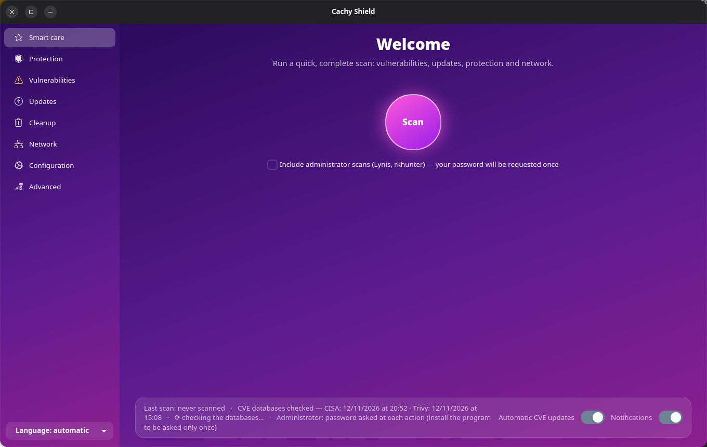
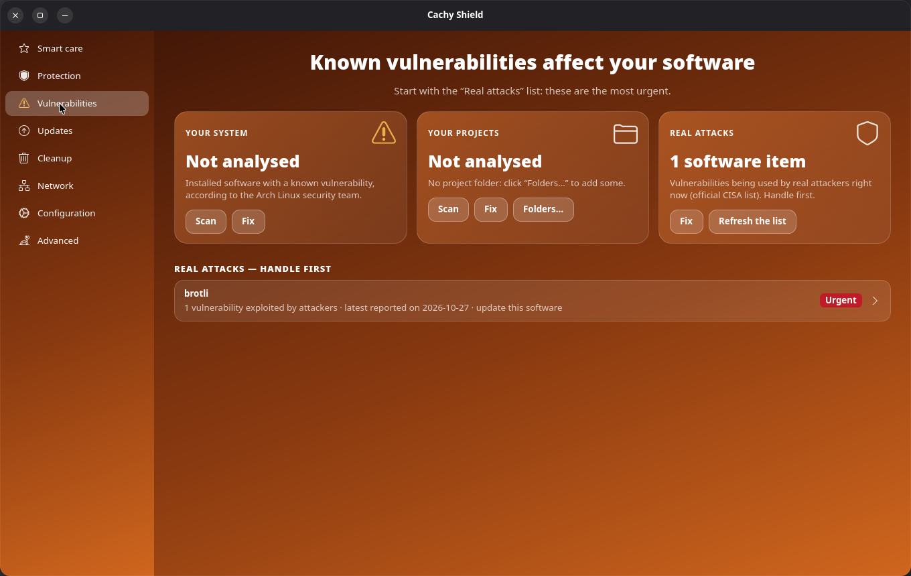
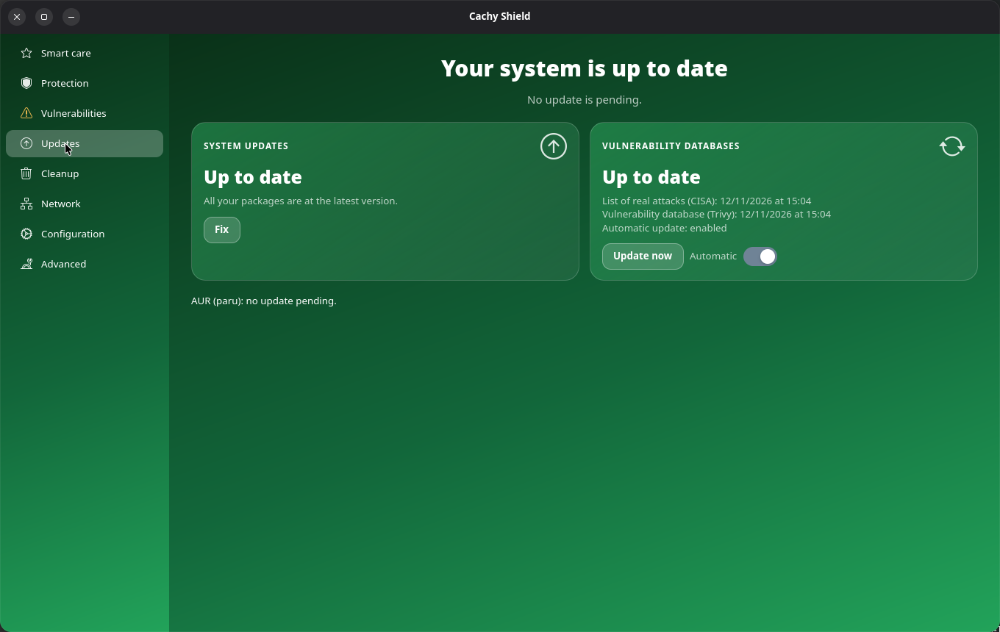
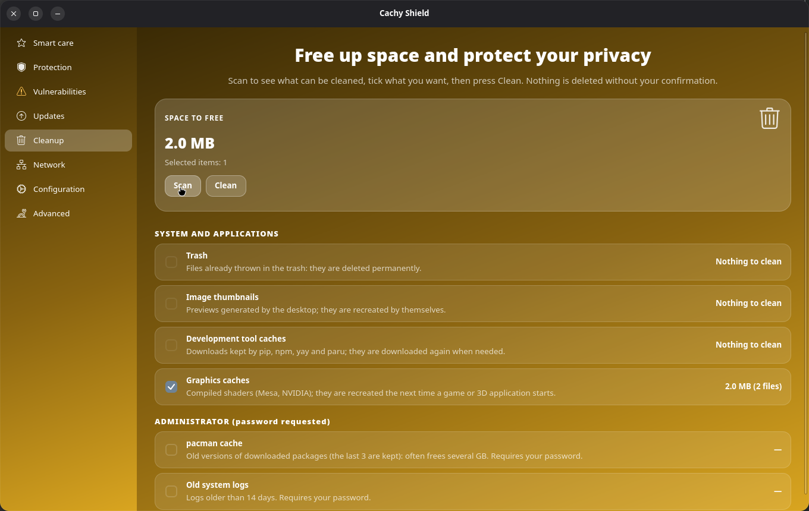
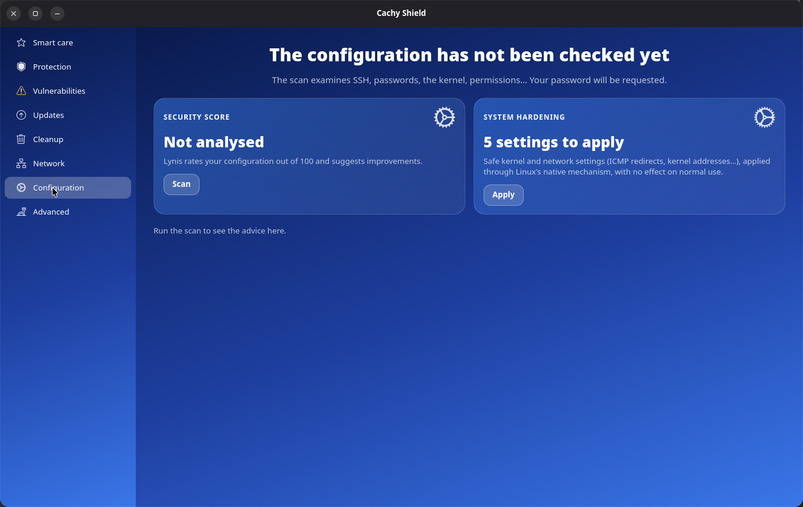

<p align="center"></p>

<h1 align="center">Cachy Shield</h1>

<p align="center">
A friendly security center for Arch Linux and Arch-based distributions.<br>
Scan → Review → Fix, in one window — built on trusted tools, with a confirmation before every change.
</p>

<p align="center"></p>

> **Independent project.** Cachy Shield is not developed, endorsed or supported by CachyOS. It runs on any Arch-based
> distribution (CachyOS, EndeavourOS, Manjaro, Arch…).

## What it does

Cachy Shield puts the usual Linux security tools behind one simple interface and explains every result in plain language.

| Page | What you get |
| --- | --- |
| **Smart care** | One round button runs every check and gives a single, prioritised summary; "Review" shows the details and "Fix" applies what is safe. |
| **Protection** | Rootkit scan ([rkhunter](https://rkhunter.sourceforge.net/)) with a check of each alert against the package database (to spot false positives), plus an SSH settings editor with explanations, safe defaults, backup and automatic rollback. |
| **Vulnerabilities** | Known CVEs in your packages ([arch-audit](https://github.com/ilpianista/arch-audit)), in installed programs' libraries ([Trivy](https://trivy.dev/)) and in your own projects ([OSV-Scanner](https://google.github.io/osv-scanner/)). "Real attacks" (CISA KEV) come first. Fixes for your projects' dependencies (npm, Python `requirements.txt`, Rust `Cargo.lock`) are previewed, backed up and never touch virtual environments. |
| **Updates** | Pending updates with risk warnings (kernel, bootloader, drivers…) and a safety snapshot ([snapper](https://github.com/openSUSE/snapper), if installed). AUR updates with PKGBUILD review. **Fix** then offers the usual clean-up, step by step: orphaned packages, old package cache (keeps 3 versions), Flatpak updates and unused runtimes, services to restart, reboot. |
| **Cleanup** | Trash, thumbnails, developer and graphics caches, browser cache/cookies/history (browser must be closed), old pacman cache and system logs. Nothing is deleted without confirmation. |
| **Network** | Listening ports and connections, services reachable from your network (the ones you allow are not flagged), a firewall editor for **ufw**, **firewalld** or a built-in nftables table (works while the firewall is off; it never turns one on by itself), and stopping or blocking a program. |
| **Configuration** | System score ([Lynis](https://cisofy.com/lynis/)) and kernel/network hardening through `sysctl.d`, compared with the current values and reversible. |
| **Advanced** | The technical view: overview dashboard, raw results and options of each tool, the world CVE catalogs (CISA KEV and NVD) and the vulnerability databases. |
| **Tray icon** | Optional. Shows a badge when updates are available, with a menu to open any page; closing the window keeps the program in the background. |

<p align="center">




</p>

## Settings

On first launch a short wizard detects the tools you have and lets you choose your **project folders** (the only folders scanned).
Then, on the home page and in the wizard: include administrator scans, **automatic CVE updates**, **notifications**, the tray
icon, a single administrator prompt, at the first action that needs it (otherwise asked at each action), firewall logging, and the **language**
(bottom left of the window).

## Install

**Quickest — ready-made release (nothing to compile).** Download `cachy-shield-<version>-x86_64.tar.gz` from the
[Releases](https://github.com/ITchrisDEB/CachyShield/releases) page, then:

```sh
sha256sum -c cachy-shield-*.tar.gz.sha256      # optional: check the download
tar -xzf cachy-shield-*.tar.gz
cd cachy-shield-*/
sudo ./install.sh
```

**From source** (a few minutes to compile the first time):

```sh
git clone https://github.com/ITchrisDEB/CachyShield.git
cd CachyShield
sudo ./install.sh
```

Both use the same installer. The program goes to `/usr/bin`, so it needs `sudo`. It tells you what is missing, offers to install
it (answer `Y`), builds the program **as you** (never as root) when installing from source, and adds **Cachy Shield** to your
applications menu. Nothing is installed without asking first.

To skip the tray icon at login: `sudo ./install.sh --no-autostart`. A regular Arch package is also available: `packaging/PKGBUILD` (`makepkg -si`).

### Where things go

| What | Where |
| --- | --- |
| Program | `/usr/bin/cachy-shield` — a root-owned folder, which the single-password-prompt design requires. (If you later install the Arch package, uninstall this copy first: `sudo cachy-shield-uninstall`.) |
| Uninstaller | `/usr/bin/cachy-shield-uninstall` — run `sudo cachy-shield-uninstall` at any time. |
| Launcher and icon | `~/.local/share/applications`, `~/.local/share/icons` (honours `XDG_DATA_HOME`) |
| Tray icon at login | `~/.config/autostart/cachy-shield-tray.desktop` (honours `XDG_CONFIG_HOME`) |
| Settings and results | `~/.config/cachy-shield`, `~/.local/share/cachy-shield` |

## Uninstall

```sh
sudo cachy-shield-uninstall     # from any folder: you can delete the cloned folder after installing
sudo pacman -R cachy-shield     # if you installed the Arch package instead
```

Your settings and results are kept (delete `~/.config/cachy-shield` and `~/.local/share/cachy-shield` to remove them too).
Changes applied to the *system* from the application (SSH drop-in, kernel hardening, firewall rules) are not removed:
revert them in the application first, or delete `/etc/ssh/sshd_config.d/10-cachy-shield.conf` and
`/etc/sysctl.d/99-cachy-shield.conf`. Close the program and its tray icon before uninstalling.

## Dependencies

| | Packages |
| --- | --- |
| **Required** (build and run) | `gtk4` `libadwaita` `polkit` `pacman-contrib` `iproute2` `nftables` `curl` · build: `rust` `gcc` `make` `pkgconf` |
| **Scanners** (offered by the installer) | `arch-audit` `lynis` `rkhunter` `trivy` `osv-scanner` — the application is built on them; each page works without its tool but skips that check. Helpers for more complete Lynis and rkhunter results: `net-tools` `unhide` (rkhunter itself pulls in `wget` and `perl`) |
| **Optional** | `git` + `base-devel` (in-app AUR updates: `makepkg`) · a terminal emulator (`konsole`, `kitty`, `alacritty`, `gnome-terminal` or `xterm`, for the AUR "update in a terminal" option) · `openssh` (the SSH editor validates with `sshd -t`) · `snapper` (safety snapshot before changes) · `ufw` or `firewalld` (firewall backend; otherwise a built-in nftables table) · `paru` or `yay` (AUR updates) · `archlinux-contrib` (restart services after an update) · `flatpak` (update Flatpak apps) · `npm` / `rust` (provides `cargo`) to fix your projects' dependencies |

`sudo ./install.sh` offers to install all of this for you. To do it yourself with `pacman` — every package below is in the official
repositories (`core`/`extra`), except `paru`/`yay`, which are in the AUR (CachyOS ships them in its own repository):

```sh
# required
sudo pacman -S --needed gtk4 libadwaita polkit pacman-contrib iproute2 nftables curl rust gcc make pkgconf
# scanners (recommended) and helpers
sudo pacman -S --needed arch-audit lynis rkhunter trivy osv-scanner net-tools unhide
# optional, as you need them
sudo pacman -S --needed git base-devel openssh snapper ufw archlinux-contrib flatpak
# AUR helper (optional). CachyOS: sudo pacman -S paru   ·   Arch: git clone https://aur.archlinux.org/paru.git && cd paru && makepkg -si
```

With an AUR helper the same commands work, e.g. `paru -S --needed arch-audit lynis rkhunter trivy osv-scanner`.

The base system (`systemd`, `util-linux`, `procps-ng`, `coreutils`, `grep`, `sed`, `pacman`) and a notification daemon (any desktop has one) are assumed.
Cachy Shield does **not** depend on `cachy-update`/`arch-update`; it implements its own update maintenance.

## Safety

* **Nothing changes without your click.** Every action that modifies the system shows what it will do first, and the
  firewall is never turned on by itself.
* **One password prompt.** Administrator rights are requested once, at the first action that needs them ([how it works](SECURITY.md#how-administrator-rights-work)).
* **AUR packages are never installed silently** — you read each PKGBUILD first.
* **Your projects stay safe.** Virtual environments are never modified; dependency fixes keep a backup.
* **Safe Rust**: `unsafe` code is forbidden.

## Vulnerability data (CVE)

Results are matched against public sources and sorted by urgency:

* **CISA KEV** — vulnerabilities known to be exploited in real attacks; shown first as "real attacks".
* **NVD** — severity scores (CVSS) and descriptions.
* **Arch Linux security tracker** — which Arch packages are affected and whether a fixed version exists (via `arch-audit`).
* **Trivy and OSV databases** — vulnerabilities in program libraries and in your own projects.

The databases refresh automatically (switch "Automatic CVE updates" on the home page, or the **Advanced** page for details).
Your package list never leaves your machine; see [Privacy](#privacy-and-network-use).

## Privacy and network use

Cachy Shield has no telemetry and no account. It contacts, only to do its job: the CISA KEV catalog, the NVD, the
Arch Linux security tracker, the Trivy and OSV vulnerability databases, and — for packages that are not in the official
repositories — the public AUR RPC (only the package *name* is sent). Automatic database updates can be turned off.
Results and settings stay in `~/.local/share/cachy-shield` and `~/.config/cachy-shield`.

## Languages

English, French, Deutsch, Español, Italiano and Nederlands are bundled. The language follows your system locale and can be
changed in the application (bottom left of the window). To add another language without rebuilding, drop a file
`~/.config/cachy-shield/lang/<code>.tsv` (`French text<TAB>translation`); see [CONTRIBUTING.md](CONTRIBUTING.md) for the
bundled catalogs.

## Build and test

```sh
cargo build --release --locked
cargo test --locked
```

Contributions are welcome — see [CONTRIBUTING.md](CONTRIBUTING.md). To report a vulnerability, see [SECURITY.md](SECURITY.md).

## License

[MIT](LICENSE)
